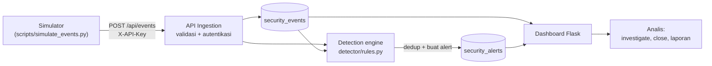
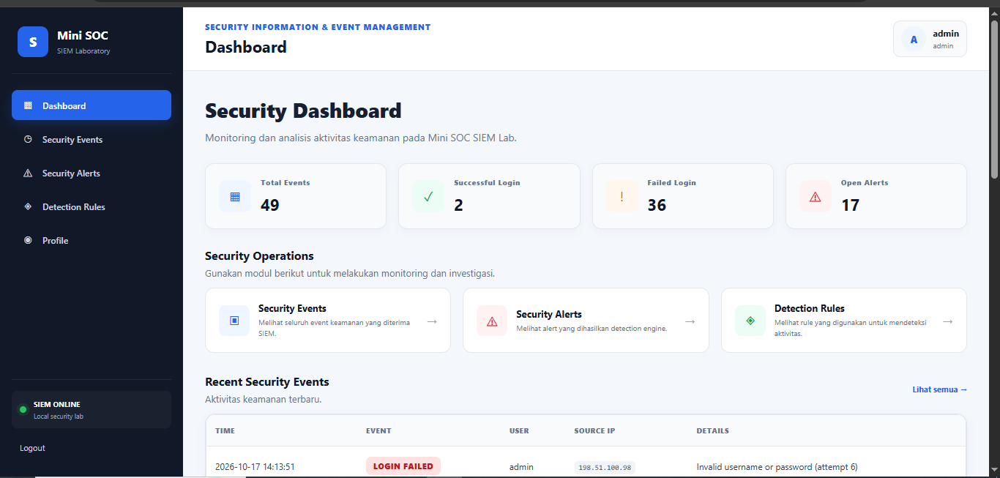
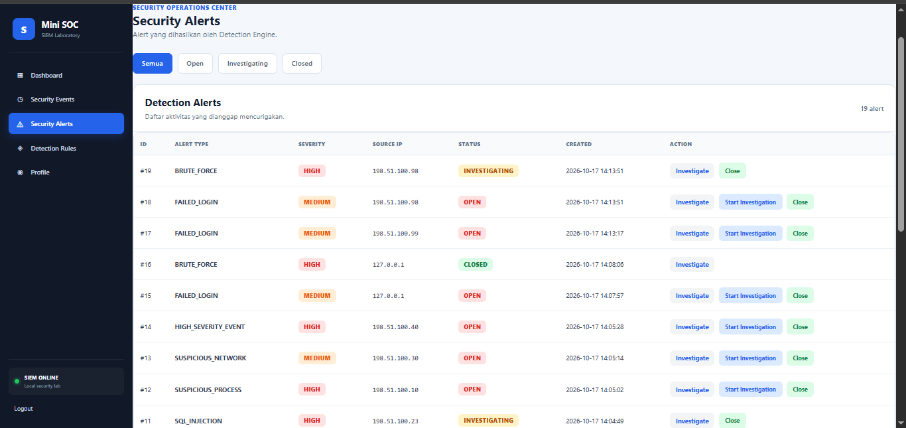
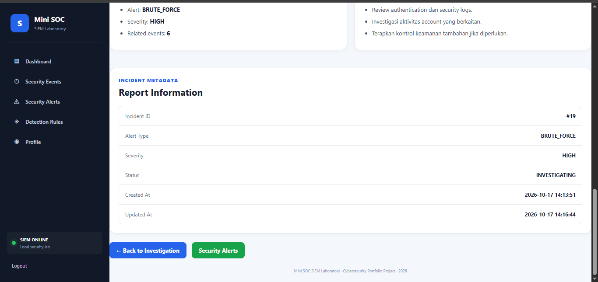
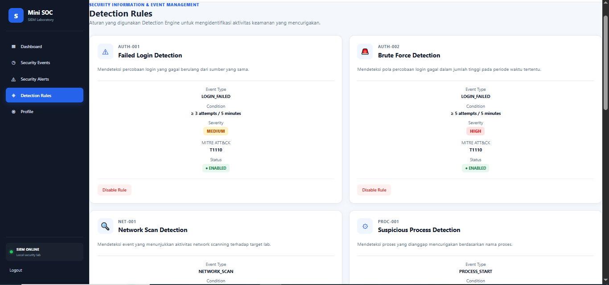

# Mini SOC Dashboard

Laboratorium **SIEM / SOC** mini yang berdiri sendiri, dibuat dengan Python dan
Flask. Aplikasi ini menerima event keamanan lewat API, mendeteksi pola
mencurigakan dengan rule engine, membuat alert yang sudah dideduplikasi, dan
menyediakan dashboard bagi analis untuk menginvestigasi, menutup alert, dan
membaca laporan insiden.

Project ini adalah lab pembelajaran sekaligus portofolio. Aplikasi hanya
berjalan di `127.0.0.1` dan diuji dengan **event sintetis** dari simulator
bawaan, sehingga tidak ada sistem nyata yang diserang.

## Fitur

- **API ingestion event** (`POST /api/events`) dengan autentikasi API key dan
  validasi input yang ketat.
- **Detection engine** dengan 7 rule, masing-masing dipetakan ke teknik MITRE
  ATT&CK: brute force, login gagal berulang, network scan, proses mencurigakan,
  koneksi jaringan mencurigakan, pola SQL injection, dan event berseverity tinggi.
- **Korelasi berbasis jendela waktu**: login gagal dihitung per IP sumber dalam
  jendela 5 menit langsung di SQL.
- **Deduplikasi alert**: aktivitas berulang memperbarui satu alert yang masih
  terbuka, bukan membanjiri antrean (7 login gagal menghasilkan 2 alert, bukan 7).
- **Alur kerja analis**: pencarian dan filter event, detail event, antrean
  alert, investigate / close, halaman incident, dan halaman incident report.
- **Akses berbasis role**: `admin` dapat mengaktifkan atau menonaktifkan
  detection rule, `analyst` tidak.
- **Halaman Detections** dibuat dari satu registry rule, dengan tombol
  enable/disable.
- **Simulator serangan** (`scripts/simulate_events.py`) untuk menguji semua
  rule dari terminal.
- **Pengujian otomatis** (36 test, hanya memakai library standar Python).

## Arsitektur



Alur: **buat aktivitas -> ingest event -> deteksi -> buat alert ->
investigasi -> laporan.**

## Teknologi

Python 3, Flask, SQLite, template Jinja2, HTML/CSS/JavaScript. Tidak perlu
database server dan tidak ada dependensi runtime selain Flask.

## Struktur project

```
mini-soc-dashboard/
├── app.py                    # Aplikasi Flask: route, auth, CSRF, API ingestion
├── config.py                 # Konfigurasi environment / .env
├── db.py                     # Skema, event, alert, deduplikasi
├── detector/
│   ├── rules.py              # Fungsi rule + registry rule (pemetaan MITRE)
│   └── detection_engine.py   # Menjalankan rule aktif, membuat alert
├── scripts/
│   └── simulate_events.py    # Simulator serangan dari terminal
├── templates/ static/        # Tampilan dashboard
├── tests/                    # Unit test dan integration test (unittest)
├── reports/                  # Laporan insiden dan template
├── screenshots/              # Gambar yang dipakai README ini
├── .env.example              # Template konfigurasi
├── scope.md                  # Ruang lingkup dan batasan lab
└── requirements.txt
```

## Memulai

Membutuhkan Python 3.10 atau lebih baru.

**Windows (PowerShell)**

```powershell
python -m venv venv
.\venv\Scripts\Activate.ps1
pip install -r requirements.txt
Copy-Item .env.example .env
```

**Linux / macOS**

```bash
python3 -m venv venv
source venv/bin/activate
pip install -r requirements.txt
cp .env.example .env
```

Edit `.env` lalu isi `SIEM_API_KEY` dan `SECRET_KEY`. Buat nilai acak dengan:

```
python -c "import secrets; print(secrets.token_hex(32))"
```

Jalankan aplikasi:

```
python app.py
```

Buka http://127.0.0.1:5000.

Pada run pertama, database dibuat dan akun `admin` serta `analyst`
ditambahkan. Jika `ADMIN_PASSWORD` / `ANALYST_PASSWORD` kosong di `.env`,
password acak dibuat dan **hanya ditampilkan sekali di console**; salin saat
itu juga. Untuk memulai dari kondisi bersih, hentikan aplikasi lalu hapus
`database/soc.db`.

## Konfigurasi

Semua pengaturan dibaca dari environment variable atau dari `.env`.

| Variabel | Fungsi | Jika kosong |
|---|---|---|
| `SIEM_API_KEY` | Kunci yang wajib untuk `POST /api/events` (header `X-API-Key`) | API ingestion nonaktif (HTTP 503) |
| `SECRET_KEY` | Menandatangani cookie session Flask | Kunci acak dipakai sampai aplikasi di-restart |
| `ADMIN_PASSWORD`, `ANALYST_PASSWORD` | Password awal akun | Acak, ditampilkan sekali di console |
| `FLASK_DEBUG` | `1` mengaktifkan mode debug Flask | Mati |
| `HOST`, `PORT` | Alamat bind (default `127.0.0.1:5000`) | Default |
| `SESSION_COOKIE_SECURE` | `1` menandai cookie session sebagai Secure (butuh HTTPS) | Mati |

`.env` sudah masuk `.gitignore` dan tidak boleh di-commit.

## Detection rules

| Kode | Rule | Kondisi | Severity alert | MITRE ATT&CK |
|---|---|---|---|---|
| AUTH-001 | Repeated Failed Login | 3 atau lebih login gagal dari satu IP dalam 5 menit | MEDIUM | T1110 |
| AUTH-002 | Brute Force Login | 5 atau lebih login gagal dari satu IP dalam 5 menit | HIGH | T1110 |
| NET-001 | Network Scan | Event `NETWORK_SCAN` | MEDIUM | T1046 |
| PROC-001 | Suspicious Process | `PROCESS_START` untuk `powershell.exe`, `cmd.exe`, `wscript.exe`, `cscript.exe`, `mshta.exe`, `rundll32.exe`, `regsvr32.exe`, `certutil.exe`, atau `bitsadmin.exe` (path lengkap juga dikenali) | HIGH | T1059 / T1218 |
| NET-002 | Suspicious Network Connection | `NETWORK_CONNECTION` ke port 4444, 1337, 31337, 5555, atau 6666 (dari `destination_port` atau dari teks details) | MEDIUM | T1571 |
| SEV-001 | High Severity Event | Event apa pun dengan severity `HIGH` atau `CRITICAL` | HIGH / CRITICAL | - |
| WEB-001 | SQL Injection Pattern | `WEB_REQUEST` yang cocok dengan pola tautology, `UNION SELECT`, stacked query, time-based, enumerasi skema, atau komentar setelah tanda kutip (di-URL-decode terlebih dahulu) | HIGH | T1190 |

Ambang batas, watchlist, dan pola adalah konstanta di bagian atas
`detector/rules.py`. Rule dapat diaktifkan atau dinonaktifkan oleh admin di
halaman **Detections**.

### Siklus alert dan deduplikasi

Alert bergerak melalui `OPEN -> INVESTIGATING -> CLOSED`. Selama sebuah alert
dengan tipe dan IP sumber yang sama (serta proses atau tujuan yang sama untuk
PROC-001 dan NET-002) berstatus `OPEN` atau `INVESTIGATING` dan dibuat dalam
15 menit terakhir, aktivitas baru yang cocok hanya memperbarui alert tersebut.
Setelah alert ditutup, aktivitas baru akan membuat alert baru.

## API ingestion SIEM

`POST /api/events` dengan header `X-API-Key` dan body JSON.

| Field | Wajib | Catatan |
|---|---|---|
| `event_type` | ya | `A-Z`, `0-9`, `_`, 3 sampai 40 karakter; huruf kecil diubah menjadi kapital |
| `source_ip`, `destination_ip` | tidak | IPv4/IPv6 yang valid; `::1` disimpan sebagai `127.0.0.1` |
| `destination_port` | tidak | Bilangan bulat 0 sampai 65535 |
| `username` | tidak | Maksimal 64 karakter |
| `process_name` | tidak | Maksimal 128 karakter |
| `details` | tidak | Maksimal 500 karakter |
| `severity` | tidak | `INFO`, `LOW`, `WARNING`, `MEDIUM`, `HIGH`, `CRITICAL` (default `INFO`) |

Respons: `201` beserta `event_id` dan alert yang baru dibuat oleh event
tersebut, `400` untuk input tidak valid, `401` untuk key yang salah, `503` jika
key belum dikonfigurasi. Ukuran body request dibatasi 64 KB.

Contoh PowerShell:

```powershell
Invoke-RestMethod -Uri http://127.0.0.1:5000/api/events -Method Post `
  -Headers @{ "X-API-Key" = "<SIEM_API_KEY kamu>" } `
  -ContentType "application/json" `
  -Body '{"event_type":"NETWORK_SCAN","source_ip":"203.0.113.50","details":"Port scan"}'
```

`GET /api/health` mengembalikan status layanan tanpa autentikasi.

## Pengujian

### 1. Simulasi serangan manual

Jalankan aplikasi di satu terminal, lalu buka terminal kedua di folder project:

```
python scripts/simulate_events.py brute-force
python scripts/simulate_events.py all
```

Simulator hanya mengirim event sintetis ke API lokal, dengan rentang IP
dokumentasi `203.0.113.0/24` sebagai sumber. Untuk setiap event, simulator
menampilkan alert yang dibuat oleh event itu.

| Skenario | Event yang dikirim | Alert baru yang diharapkan |
|---|---|---|
| `failed-login` | 1 `LOGIN_FAILED` | tidak ada (di bawah ambang 3 kegagalan) |
| `brute-force` | 6 `LOGIN_FAILED` (`--count` untuk mengubah, minimal 5) | `FAILED_LOGIN` / MEDIUM pada kegagalan ke-3, `BRUTE_FORCE` / HIGH pada kegagalan ke-5 |
| `network-scan` | 1 `NETWORK_SCAN` | `NETWORK_SCAN` / MEDIUM |
| `suspicious-process` | `PROCESS_START` untuk `powershell.exe` | `SUSPICIOUS_PROCESS` / HIGH |
| `suspicious-network` | `NETWORK_CONNECTION` ke `:4444` | `SUSPICIOUS_NETWORK` / MEDIUM |
| `sql-injection` | `WEB_REQUEST` dengan `' OR '1'='1' -- -` | `SQL_INJECTION` / HIGH |
| `high-severity` | `MALWARE_DETECTED` dengan severity HIGH | `HIGH_SEVERITY_EVENT` / HIGH |
| `all` | semua skenario di atas | total 7 alert pada database kosong |

Menjalankan skenario yang sama lagi dalam 15 menit tidak membuat alert baru,
karena alert yang masih terbuka dipakai ulang. Tutup alert di dashboard (atau
pakai `--ip` lain) agar alert muncul kembali. Opsi: `--ip`, `--count`,
`--delay`, `--url`, `--api-key`.

### 2. Pengujian otomatis

```
python -m unittest discover -s tests -t . -v
```

Ke-36 test memakai database sementara dan mencakup: ambang batas dan jendela
waktu login gagal serta brute force, deduplikasi, pelacakan per IP, rule yang
dinonaktifkan, setiap detection rule (termasuk payload SQL injection dan
request yang tidak berbahaya), autentikasi dan validasi API, proteksi CSRF
pada login, akses berbasis role, dan seluruh alur kerja alert.

## Screenshot

| Dashboard | Alerts |
|---|---|
|  |  |
| Ringkasan jumlah event, alert terbuka, dan aktivitas terbaru. | Antrean alert setelah menjalankan `simulate_events.py all`. |

| Investigasi incident | Detection rules |
|---|---|
|  |  |
| Detail alert beserta event pemicu dan event terkait. | Registry rule dengan pemetaan MITRE dan tombol enable/disable (admin). |

## Laporan insiden

Contoh laporan yang ditulis dari hasil simulasi:

- [Incident 001 - Brute Force Login](reports/incident-001.md)
- [Incident 002 - SQL Injection Attempt](reports/incident-002.md)
- [Template laporan](reports/TEMPLATE.md)

## Desain keamanan

Lab ini sendiri menerapkan praktik yang ingin didemonstrasikannya:

- Semua SQL memakai parameterized query; autoescaping Jinja2 aktif dan tidak
  ada output yang ditandai aman secara paksa.
- Password di-hash (Werkzeug); tidak ada kredensial yang disimpan di repository
  atau ditampilkan di UI.
- Secret dan API key berasal dari environment, bukan dari kode.
- Token CSRF di setiap form POST, termasuk login.
- Setiap halaman wajib login secara default; pengelolaan rule hanya untuk admin.
- API key dibandingkan secara constant-time; payload divalidasi dan dibatasi ukurannya.
- Cookie session `HttpOnly` dan `SameSite=Lax`, dengan masa berlaku 8 jam.
- Mode debug mati kecuali `FLASK_DEBUG=1`; server hanya bind ke `127.0.0.1`.

## Keterbatasan

- Deteksi berbasis rule dan bersifat heuristik. Rule SQL injection bukan WAF
  dan bisa melewatkan payload yang dikaburkan.
- Timestamp memakai waktu lokal server, bukan UTC.
- SQLite satu node dan server pengembangan Flask; tidak ditujukan untuk produksi.
- Satu API key bersama, tanpa TLS, tanpa halaman manajemen user, dan tanpa
  lockout login.
- Event hanya masuk lewat API; belum ada agent atau log shipper.

## Roadmap

- Timestamp UTC dan filter rentang waktu di halaman events.
- Lockout atau throttling login dan halaman manajemen user.
- Log shipper (misalnya forwarder Windows Event Log atau syslog).
- Pengayaan alert (GeoIP, reputasi IP) dan notifikasi (email atau webhook).
- Ekspor laporan insiden ke PDF.

## Ruang lingkup dan disclaimer

Ini adalah laboratorium keamanan edukasi lokal; lihat [scope.md](scope.md).
Gunakan hanya pada sistem milik sendiri. Jangan arahkan simulator atau API ke
sistem pihak ketiga mana pun.

Saya membuat lab ini sebenarnya bertujuan untuk latihan yang dimana lab ini bisa
menggambarkan seluruh log event atau aktivitas yang bisa saya selidiki dan saya pelajari.
Sekaligus dalam pembuatan ini saya bisa tau serangan serangan nya atau disebut pentesting,
Jadi saya disini sekalian mendalami defensif dan attacker

## Lisensi

MIT. Lihat [LICENSE](LICENSE).
Email : redigrandisvinata21@gmail.com
