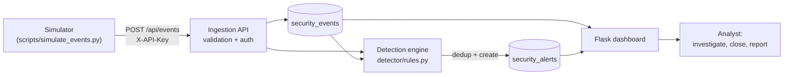

# Mini SOC Dashboard

A small, self-contained **SIEM / SOC laboratory** built with Python and Flask.
It ingests security events through an API, detects suspicious patterns with a
rule engine, raises deduplicated alerts, and gives an analyst a dashboard to
investigate, close alerts and review incident reports.

The project is a learning and portfolio lab. It runs only on `127.0.0.1` and
is tested with **synthetic events** produced by a built-in simulator, so no
real system is ever attacked.

## Features

- **Event ingestion API** (`POST /api/events`) with API-key authentication and
  strict input validation.
- **Detection engine** with 7 rules, each mapped to a MITRE ATT&CK technique:
  brute force, repeated failed logins, network scan, suspicious process,
  suspicious network connection, SQL injection patterns and high-severity events.
- **Windowed correlation**: login failures are counted per source IP inside a
  5-minute window directly in SQL.
- **Alert deduplication**: repeated activity updates one open alert instead of
  flooding the queue (7 failed logins produce 2 alerts, not 7).
- **Analyst workflow**: events search and filter, event detail, alert queue,
  investigate / close, incident page and incident report page.
- **Role-based access**: `admin` can enable or disable detection rules,
  `analyst` cannot.
- **Rules page** generated from a single rule registry, with an enable/disable switch.
- **Attack simulator** (`scripts/simulate_events.py`) to test every rule from
  the terminal.
- **Automated tests** (36 tests, standard library only).

## Architecture



Flow: **generate activity -> ingest event -> detect -> create alert ->
investigate -> report.**

## Tech stack

Python 3, Flask, SQLite, Jinja2 templates, HTML/CSS/JavaScript. No database
server and no extra runtime dependencies besides Flask.

## Project structure

```
mini-soc-dashboard/
├── app.py                    # Flask app: routes, auth, CSRF, ingestion API
├── config.py                 # Environment / .env configuration
├── db.py                     # Schema, events, alerts, deduplication
├── detector/
│   ├── rules.py              # Rule functions + rule registry (MITRE mapping)
│   └── detection_engine.py   # Runs enabled rules, creates alerts
├── scripts/
│   └── simulate_events.py    # Terminal attack simulator
├── templates/ static/        # Dashboard UI
├── tests/                    # Unit and integration tests (unittest)
├── reports/                  # Incident reports and template
├── screenshots/              # Images used by this README
├── .env.example              # Configuration template
├── scope.md                  # Lab scope and boundaries
└── requirements.txt
```

## Quick start

Requires Python 3.10 or newer.

**Windows (PowerShell)**

```powershell
python -m venv venv
.\venv\Scripts\Activate.ps1
pip install -r requirements.txt
Copy-Item .env.example .env
```

**Linux / macOS**

```bash
python3 -m venv venv
source venv/bin/activate
pip install -r requirements.txt
cp .env.example .env
```

Edit `.env` and set `SIEM_API_KEY` and `SECRET_KEY`. Generate random values with:

```
python -c "import secrets; print(secrets.token_hex(32))"
```

Start the app:

```
python app.py
```

Open http://127.0.0.1:5000.

On the first run the database is created and the accounts `admin` and
`analyst` are added. If `ADMIN_PASSWORD` / `ANALYST_PASSWORD` are empty in
`.env`, random passwords are generated and **printed once in the console**;
copy them then. To start from a clean state, stop the app and delete
`database/soc.db`.

## Configuration

All settings are read from environment variables or from `.env`.

| Variable | Purpose | If empty |
|---|---|---|
| `SIEM_API_KEY` | Key required by `POST /api/events` (`X-API-Key` header) | The ingestion API is disabled (HTTP 503) |
| `SECRET_KEY` | Signs the Flask session cookie | A random key is used until restart |
| `ADMIN_PASSWORD`, `ANALYST_PASSWORD` | Initial account passwords | Random, shown once in the console |
| `FLASK_DEBUG` | `1` enables Flask debug mode | Off |
| `HOST`, `PORT` | Bind address (default `127.0.0.1:5000`) | Defaults |
| `SESSION_COOKIE_SECURE` | `1` marks the session cookie Secure (needs HTTPS) | Off |

`.env` is listed in `.gitignore` and must never be committed.

## Detection rules

| Code | Rule | Condition | Alert severity | MITRE ATT&CK |
|---|---|---|---|---|
| AUTH-001 | Repeated Failed Login | 3 or more failed logins from one IP in 5 minutes | MEDIUM | T1110 |
| AUTH-002 | Brute Force Login | 5 or more failed logins from one IP in 5 minutes | HIGH | T1110 |
| NET-001 | Network Scan | `NETWORK_SCAN` event | MEDIUM | T1046 |
| PROC-001 | Suspicious Process | `PROCESS_START` of `powershell.exe`, `cmd.exe`, `wscript.exe`, `cscript.exe`, `mshta.exe`, `rundll32.exe`, `regsvr32.exe`, `certutil.exe` or `bitsadmin.exe` (full paths are handled) | HIGH | T1059 / T1218 |
| NET-002 | Suspicious Network Connection | `NETWORK_CONNECTION` to port 4444, 1337, 31337, 5555 or 6666 (from `destination_port` or from the details text) | MEDIUM | T1571 |
| SEV-001 | High Severity Event | Any event with severity `HIGH` or `CRITICAL` | HIGH / CRITICAL | - |
| WEB-001 | SQL Injection Pattern | `WEB_REQUEST` matching tautology, `UNION SELECT`, stacked query, time-based, schema enumeration or comment-after-quote patterns (URL-decoded first) | HIGH | T1190 |

Thresholds, watchlists and patterns are constants at the top of
`detector/rules.py`. Rules can be enabled or disabled by an admin on the
**Detections** page.

### Alert lifecycle and deduplication

Alerts move through `OPEN -> INVESTIGATING -> CLOSED`. While an alert of the
same type and source IP (and the same process or destination for PROC-001 and
NET-002) is `OPEN` or `INVESTIGATING` and was created within the last 15
minutes, new matching activity only updates that alert. Once it is closed, new
activity creates a new alert.

## SIEM ingestion API

`POST /api/events` with header `X-API-Key` and a JSON body.

| Field | Required | Notes |
|---|---|---|
| `event_type` | yes | `A-Z`, `0-9`, `_`, 3 to 40 characters; lowercase is upper-cased |
| `source_ip`, `destination_ip` | no | Valid IPv4/IPv6; `::1` is stored as `127.0.0.1` |
| `destination_port` | no | Integer 0 to 65535 |
| `username` | no | Up to 64 characters |
| `process_name` | no | Up to 128 characters |
| `details` | no | Up to 500 characters |
| `severity` | no | `INFO`, `LOW`, `WARNING`, `MEDIUM`, `HIGH`, `CRITICAL` (default `INFO`) |

Responses: `201` with the stored `event_id` and the alerts newly created by this
event, `400` for invalid input, `401` for a wrong key, `503` if no key is
configured. Request bodies are limited to 64 KB.

PowerShell example:

```powershell
Invoke-RestMethod -Uri http://127.0.0.1:5000/api/events -Method Post `
  -Headers @{ "X-API-Key" = "<your SIEM_API_KEY>" } `
  -ContentType "application/json" `
  -Body '{"event_type":"NETWORK_SCAN","source_ip":"203.0.113.50","details":"Port scan"}'
```

`GET /api/health` returns the service status without authentication.

## Testing

### 1. Manual attack simulation

Start the app in one terminal, then open a second terminal in the project
folder:

```
python scripts/simulate_events.py brute-force
python scripts/simulate_events.py all
```

The simulator sends synthetic events to the local API only, using the
documentation IP range `203.0.113.0/24` as the source. For every event it
prints the alerts that event created.

| Scenario | Events sent | Expected new alert |
|---|---|---|
| `failed-login` | 1 `LOGIN_FAILED` | none (below the 3-failure threshold) |
| `brute-force` | 6 `LOGIN_FAILED` (`--count` to change, minimum 5) | `FAILED_LOGIN` / MEDIUM on the 3rd failure, `BRUTE_FORCE` / HIGH on the 5th |
| `network-scan` | 1 `NETWORK_SCAN` | `NETWORK_SCAN` / MEDIUM |
| `suspicious-process` | `PROCESS_START` of `powershell.exe` | `SUSPICIOUS_PROCESS` / HIGH |
| `suspicious-network` | `NETWORK_CONNECTION` to `:4444` | `SUSPICIOUS_NETWORK` / MEDIUM |
| `sql-injection` | `WEB_REQUEST` with `' OR '1'='1' -- -` | `SQL_INJECTION` / HIGH |
| `high-severity` | `MALWARE_DETECTED` with severity HIGH | `HIGH_SEVERITY_EVENT` / HIGH |
| `all` | all of the above | 7 alerts in total on an empty database |

Running a scenario again within 15 minutes creates no new alert, because the
open alert is reused. Close the alerts in the dashboard (or use another
`--ip`) to see them fire again. Options: `--ip`, `--count`, `--delay`, `--url`,
`--api-key`.

### 2. Automated tests

```
python -m unittest discover -s tests -t . -v
```

The 36 tests use a temporary database and cover: failed-login and brute-force
thresholds and time windows, deduplication, per-IP tracking, disabled rules,
every detection rule (including SQL injection payloads and benign requests),
API authentication and validation, login CSRF protection, role-based access,
and the full alert workflow.

## Screenshots

| Dashboard | Alerts |
|---|---|
|  |  |
| Overview of event counts, open alerts and recent activity. | Alert queue after running `simulate_events.py all`. |

| Incident investigation | Detection rules |
|---|---|
|  |  |
| Alert details with the triggering event and related events. | Rule registry with MITRE mapping and enable/disable switch (admin). |

## Incident reports

Example reports written from simulated runs:

- [Incident 001 - Brute Force Login](reports/incident-001.md)
- [Incident 002 - SQL Injection Attempt](reports/incident-002.md)
- [Report template](reports/TEMPLATE.md)

## Security design

The lab itself follows the practices it is meant to demonstrate:

- All SQL uses parameterized queries; Jinja2 autoescaping is on and no output is marked safe.
- Passwords are hashed (Werkzeug); no credentials are stored in the repository
  or shown in the UI.
- Secrets and the API key come from the environment, never from code.
- CSRF token on every POST form, including login.
- Every page requires login by default; rule management is admin-only.
- API key compared in constant time; payloads validated and size-limited.
- Session cookie is `HttpOnly` and `SameSite=Lax`, with an 8-hour lifetime.
- Debug mode is off unless `FLASK_DEBUG=1`; the server binds to `127.0.0.1`.

## Limitations

- Detection is rule-based and heuristic. The SQL injection rule is not a WAF
  and can miss obfuscated payloads.
- Timestamps use the server's local time, not UTC.
- Single-node SQLite and the Flask development server; not intended for production.
- One shared API key, no TLS, no user management screen and no login lockout.
- Events come from the API only; there are no agents or log shippers.

## Roadmap

- UTC timestamps and a time-range filter on the events page.
- Login lockout or throttling and a user management page.
- Log shippers (for example a Windows Event Log or syslog forwarder).
- Alert enrichment (GeoIP, IP reputation) and notifications (email or webhook).
- Export of incident reports to PDF.

## Scope and disclaimer

This is a local educational security laboratory; see [scope.md](scope.md).
Use it only on systems you own. Do not point the simulator or the API at any
third-party system.

## License

MIT. See [LICENSE](LICENSE).
